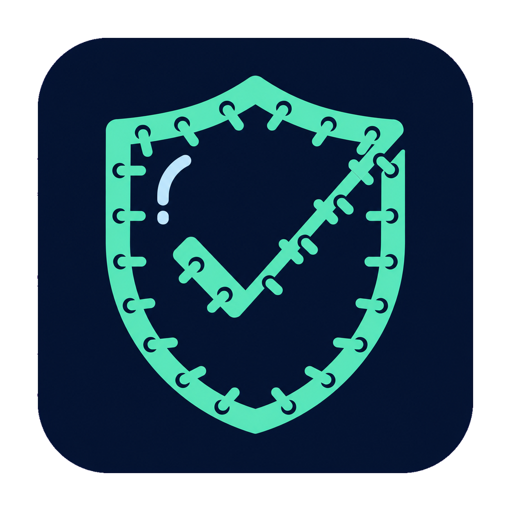

<p align="center">
  
</p>

<h1 align="center">ReleaseSuture</h1>

<p align="center">
  完全离线、只读输入的跨层发布证据鉴定工具。
</p>

<p align="center">
  <a href="https://github.com/cieyyy/ReleaseSuture/actions/workflows/ci.yml"></a>
  <a href="./LICENSE"></a>
  
  
</p>

<p align="center">
  简体中文 · <a href="./README_EN.md">English</a>
</p>

ReleaseSuture 将人工准备并完成脱敏的 SQL、Kubernetes YAML、JAR 和 Web 产物副本编译为统一、可追溯的发布风险报告。它帮助评审者在发布前把数据库、工作负载、后端包和前端静态资源放到同一条证据链中检查。

> [!IMPORTANT]
> ReleaseSuture 不连接集群、数据库、服务器、镜像仓库或任何业务系统，不执行发布、修复、回滚或报告中的建议命令。请勿向项目、Issue 或证据目录提交真实生产数据和凭据。

## 为什么需要它

发布事故往往来自跨层变化没有被一起审查：

- SQL 能执行，但实际上是全量初始化或破坏性脚本；
- Deployment 使用单副本、`Recreate`、不稳定镜像标签或缺少探针；
- JAR 中混入破坏性迁移、SNAPSHOT 版本或疑似明文凭据；
- HTML 引用了未进入产物的资源，或携带 Source Map；
- 每层都有零散检查，却缺少统一指纹、结论和人工评审顺序。

ReleaseSuture 的目标是把这些离线副本转换成可归档、可复现、机器可读的发布证据，而不是成为另一个生产环境客户端。

## 核心特性

- **离线安全边界**：核心源码不引入网络或子进程模块；
- **只读证据输入**：扫描用户明确指定的本地目录；
- **统一风险模型**：输出稳定的 JSON 与可读 Markdown；
- **证据可追溯**：记录相对路径、SHA-256、规则和脱敏摘录；
- **跨层检查**：覆盖 SQL、Kubernetes YAML、JAR 和 Web dist；
- **桌面与 CLI**：Windows 桌面界面和命令行共用同一扫描核心；
- **默认不执行**：报告中的命令仅供人工参考，工具不会调用。

## 快速开始

要求 Node.js 22 或更高版本。CLI 核心只使用 Node.js 标准库，不需要先安装依赖。

```powershell
node .\src\cli.js scan .\examples\risky-release --output .\tmp\example-report
```

生成结果：

```text
tmp/example-report/
├── report.json   # 稳定的机器可读证据模型
└── report.md     # 面向人工评审的中文报告
```

运行测试：

```powershell
npm test
```

运行完整本地检查：

```powershell
npm run check
```

## Windows 桌面版

桌面版提供本地目录选择、扫描进度、风险汇总和证据列表。首次开发运行需要从公共 npm 获取 Electron 开发依赖；运行后的扫描仍然完全离线。

```powershell
npm install
npm run desktop:start
```

打包 Windows x64 桌面程序：

```powershell
npm run desktop:package
```

入口文件位于：

```text
out/ReleaseSuture-win32-x64/ReleaseSuture.exe
```

桌面进程只加载随程序打包的本地页面，并拒绝网络请求、权限申请、页面导航和新窗口。完整边界见 [SAFETY.md](./SAFETY.md)。

## 证据目录约定

ReleaseSuture 根据文件内容和后缀识别证据。推荐使用以下目录区分现状、旧产物和待发布产物：

```text
release-case/
├── live-snapshot/      # 人工导出的脱敏现状快照
├── old-artifacts/      # 当前版本的本地产物副本
└── new-artifacts/      # 待发布版本的本地产物副本
    ├── db/*.sql
    ├── k8s/*.yaml
    ├── backend/*.jar
    └── web/**
```

| 类型 | 当前检查重点 |
| --- | --- |
| SQL | `DROP`、`TRUNCATE`、无 `WHERE` 的 `DELETE`、危险 `ALTER`、全量初始化特征 |
| Kubernetes YAML | 单副本、`Recreate`、`latest`/无标签镜像、缺少探针或资源限制、Ingress 无 TLS |
| JAR | 迁移脚本清单、破坏性 SQL、SNAPSHOT 版本、疑似明文数据库密码 |
| Web dist | HTML 引用缺失、HTTP 外部资源、Source Map 泄露 |

## 结论含义

- `BLOCKED`：目标产物存在明确的 Critical/High 阻断项；
- `REVIEW_REQUIRED`：现状证据存在需要人工判断的高风险；
- `READY_FOR_MANUAL_REVIEW`：当前规则未发现阻断项，仍不代表生产发布安全。

## CLI

```text
release-suture scan <case-directory> [--output <directory>] [--fail-on <severity>]
```

严重级别从高到低为 `critical`、`high`、`medium`、`low`、`info`。达到 `--fail-on` 阈值时进程返回非零退出码，适合用于离线制品门禁。

## 架构与安全

- [架构说明](./docs/ARCHITECTURE.md)
- [安全边界](./SAFETY.md)
- [漏洞披露策略](./SECURITY.md)
- [开源准备清单](./docs/OPEN_SOURCE_READINESS.md)

## 项目状态与路线

项目当前处于 `v0.1.x` 早期阶段，报告模型和规则仍可能演进。

- `v0.1`：离线证据模型、四类扫描器、JSON/Markdown 报告、Windows 桌面版；
- `v0.2`：版本间语义差异、规则配置、SARIF 输出；
- `v0.3`：插件式解析器、签名证据包、CI 离线制品检查；
- 后续：在保持核心无网络、无执行能力的前提下，允许外部适配器生成标准证据目录。

## 非目标

- 不是 CD 平台或生产运维客户端；
- 不是数据库迁移执行器；
- 不自动修复、发布、审批、扩缩容或回滚；
- 不替代生产变更评审和人工确认。

## 参与项目

提交代码前请阅读 [CONTRIBUTING.md](./CONTRIBUTING.md) 和 [CODE_OF_CONDUCT.md](./CODE_OF_CONDUCT.md)。问题与功能建议请使用仓库模板；安全问题请按照 [SECURITY.md](./SECURITY.md) 私下报告。

## License

本项目基于 [Apache License 2.0](./LICENSE) 开源。
