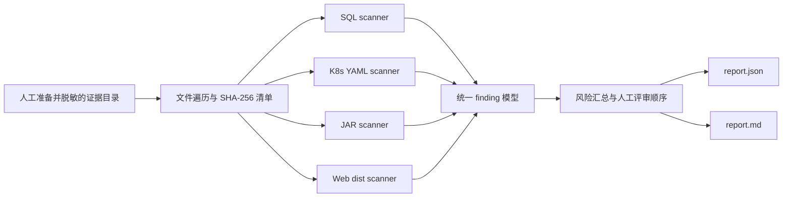

# Architecture

## 目标

ReleaseSuture 将一个由用户明确提供的本地证据目录转换为两个报告文件。核心设计约束是：扫描过程无网络、无子进程、无生产客户端，并且不修改输入证据。

## 模块

| 路径 | 职责 |
| --- | --- |
| `src/cli.js` | CLI 参数、报告目录写入和退出码 |
| `src/scan-case.js` | 证据遍历、扫描器路由、统一汇总 |
| `src/scanners/` | SQL、Kubernetes、JAR、Web 规则 |
| `src/lib/finding.js` | 稳定 finding 结构和脱敏证据 |
| `src/lib/release-plan.js` | 人工评审阶段与门禁 |
| `src/lib/report.js` | Markdown 报告渲染 |
| `desktop/service.js` | 桌面端路径边界和报告写入 |
| `desktop/main.js` | Electron 隔离、IPC 白名单和本地窗口 |

## 数据流和写入边界

1. 用户显式选择证据目录；
2. `walkFiles` 只遍历该目录；
3. 每个文件记录相对路径、大小和 SHA-256；
4. 识别的文件交给对应扫描器，不识别的文件只进入清单；
5. finding 经过统一排序、汇总并生成 release plan；
6. CLI 或桌面 service 仅向独立报告目录写入 `report.json` 和 `report.md`。

桌面端禁止把报告目录放在证据目录内部，避免扫描结果污染后续证据。

## 扩展规则

新增扫描器或规则必须保持：

- 不引入网络、子进程或生产客户端；
- 不读取证据目录外路径；
- 不释放不可信归档内容到磁盘；
- 只保留最小化、脱敏的证据；
- 同时提供命中、不命中和边界测试。

更详细的安全约束见 [SAFETY.md](../SAFETY.md)。
